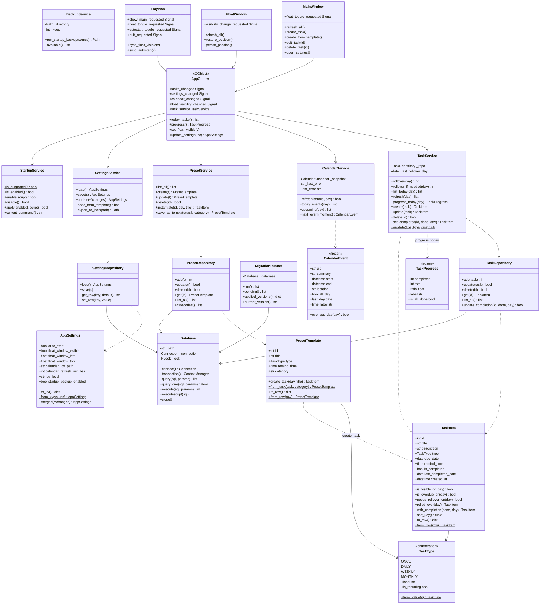
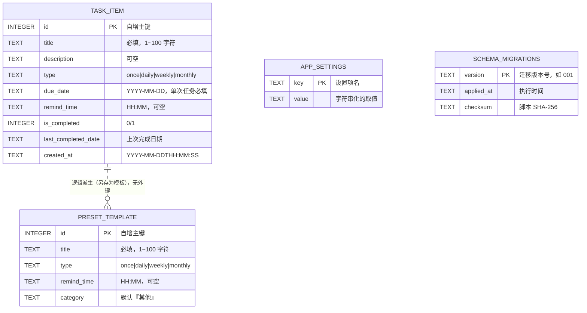
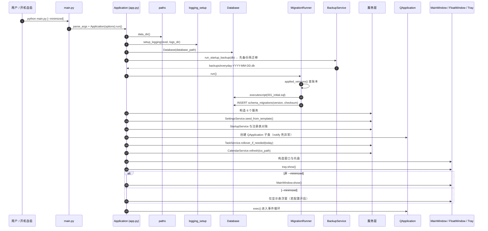
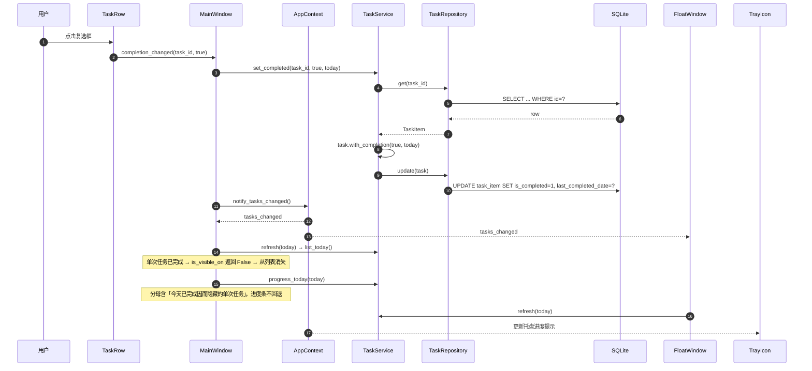
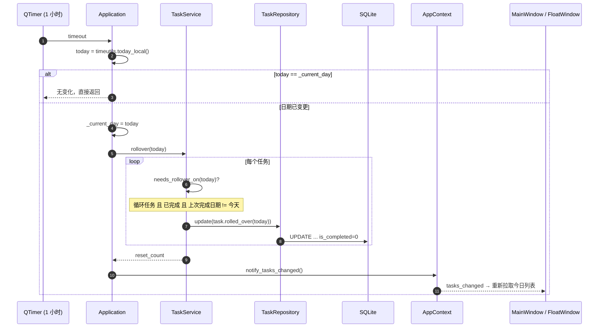
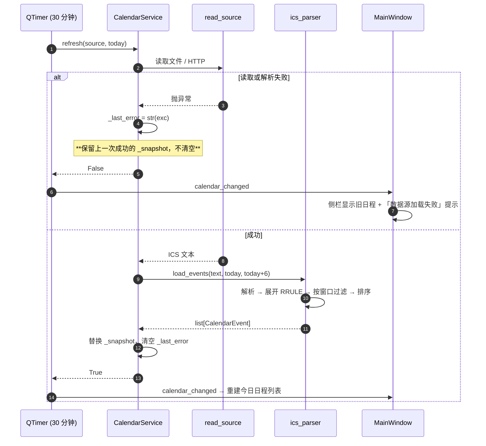

# EveryDay 架构说明

对应《每日计划软件 V1 技术实现文档》第三章「系统架构」。

---

## 1. 分层与依赖方向

```
┌──────────────────────────────────────────────────────────────┐
│ 表示层  everyday.ui                                          │
│   MainWindow · FloatWindow · TaskDialog · PresetDialog        │
│   SettingsDialog · TrayIcon · TaskRow · AppContext           │
│   （唯一依赖 PySide6 的包）                                   │
└───────────────────────────┬──────────────────────────────────┘
                            │ 只通过 AppContext 取服务、发信号
┌───────────────────────────▼──────────────────────────────────┐
│ 服务层  everyday.services                                    │
│   TaskService · CalendarService · IcsParser · StartupService  │
│   PresetService · BackupService · SettingsService            │
│   （纯标准库，无 GUI 依赖，可完整单测）                        │
└───────────────────────────┬──────────────────────────────────┘
┌───────────────────────────▼──────────────────────────────────┐
│ 数据层  everyday.db                                          │
│   Database（连接/PRAGMA/事务）· MigrationRunner · 三个仓储     │
└───────────────────────────┬──────────────────────────────────┘
┌───────────────────────────▼──────────────────────────────────┐
│ 实体层  everyday.models                                      │
│   TaskItem · PresetTemplate · AppSettings                    │
│   （实体自带业务规则，纯函数式，无 IO）                        │
└──────────────────────────────────────────────────────────────┘

横切关注点：paths · timeutils · logging_setup · exceptions
```

**关键约束**：依赖箭头只能向下。`services` 不 import `ui`，
`db` 不 import `services`，`models` 不 import 任何项目内模块（只依赖 `timeutils`）。

这样做的收益：`services` / `db` / `models` 的测试不需要 GUI、
不需要数据库文件，用内存 SQLite 即可，运行时间在毫秒级。

---

## 2. 类图



---

## 3. 实体关系图（ER）



**说明**

* 三个业务表之间**没有物理外键**：任务与模板是彼此独立的概念，
  模板只是「常用任务的速记」，删除模板不影响已创建的任务（文档 5.7）。
* `APP_SETTINGS` 采用键值对而非单行多列：设置项会随版本增长，
  键值表新增配置无需 `ALTER TABLE`，对外仍暴露字段固定的 `AppSettings` 类。
* 日期时间全部以 `TEXT` 存储，转换集中在 `everyday/timeutils.py`，
  保证「写入什么格式、读回什么格式」全局只有一处定义。
* `TASK_ITEM` 上有 4 个索引（`type` / `is_completed` / `due_date` / `created_at`），
  对应今日列表的过滤与排序路径。

---

## 4. 时序图

### 4.1 应用启动



### 4.2 勾选完成一个单次任务



### 4.3 循环任务跨午夜重置



### 4.4 日历加载失败时的降级



---

## 5. 关键设计决策

| 决策 | 选择 | 理由 | 代价 |
|---|---|---|---|
| GUI 框架 | PySide6 (Qt6) | V1 要求的无边框透明置顶窗、不占任务栏、系统托盘、多屏 DPI，Python 生态里只有 Qt 能全部原生支持；也是 WPF 最贴近的对应物 | 引入唯一的第三方依赖（约 150MB） |
| ICS 解析 | 自研子集 | 只需要「单次 + 常见循环」并按 7 天窗口按需展开；第三方库为完整 RFC 引入可观依赖，与本项目「零配置单机」定位不符 | 不支持 `BYDAY` / `TZID` 等高级特性（见 known-issues） |
| 设置存储 | 键值表 + 模板播种 | 避免「文件与数据库两份设置互相覆盖」；新增配置项无需迁移 | 设置值以字符串存储，类型转换集中在 `AppSettings` |
| 数据库连接 | 单长连接 + 可重入锁 | 单机单用户最简最快；避免 `:memory:` 每次连接都是新空库的陷阱；UI 与定时器线程可共享 | 不支持真并发写（桌面场景不需要） |
| 备份实现 | SQLite 在线备份 API | WAL 模式下直接复制 `.db` 会丢掉 `-wal` 中未检查点的提交，得到过期备份 | 需要源连接保持打开 |
| 图标 | `QPainter` 代码绘制 | 仓库保持纯文本、无二进制资产；任意 DPI 下按需重渲染 | 无法使用设计师提供的复杂图标 |
| 窗口解耦 | `AppContext` 信号总线 | 避免窗口互相直接调用导致「改了主窗口忘了刷悬浮窗」 | 多一层间接 |
| 迁移账本 | 记录 SHA-256 | 能发现「已执行的迁移被偷偷改动」 | 开发期调整迁移会产生告警（不阻断） |

---

## 6. 线程模型

应用**只使用 Qt 主线程**处理界面与业务，不引入工作线程：

* 数据库访问是本地 SQLite，毫秒级，不构成 UI 阻塞
* 日历网络订阅有 15 秒超时，是唯一的潜在阻塞点。**已知风险**：
  网络不可达时主线程会等待至超时（见 `docs/known-issues.md` KI-05），
  后续应移入 `QThread` 或 `QNetworkAccessManager`
* `Database` 内部使用 `threading.RLock` 串行化所有语句，
  因此未来引入工作线程时数据层已具备基本的并发安全
